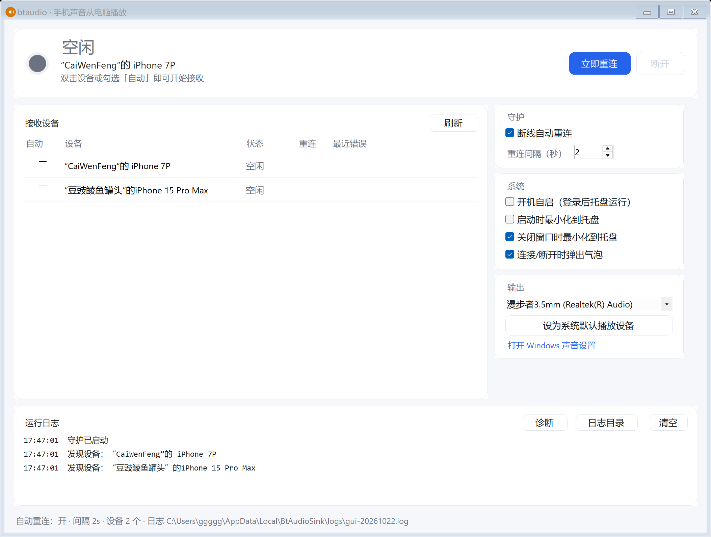

# btaudio

让手机通过蓝牙把声音送到电脑播放 —— Windows 蓝牙 A2DP 接收端（Sink）。

> **下载 → 解压 → 双击 `btaudio-gui.exe`** 就能用：手机播放的声音会从电脑的默认输出设备播放。



## 为什么会有这个项目

Windows 10 2004 起系统内置了 A2DP Sink 能力（`Windows.Media.Audio.AudioPlaybackConnection`），
但系统没有提供「接收手机音频」的开关，必须由第三方程序发起并**持续保持**连接。

[AudioPlaybackConnector](https://github.com/ysc3839/AudioPlaybackConnector) 很好用，但它只在你手点时连一次：
状态变 `Closed` 就丢弃连接、不重试、不监听设备、睡眠唤醒后通常失效。本项目重点解决这些稳定性问题，
并提供 **图形界面** 与 **命令行** 两种形态（共用同一套接收逻辑，互斥运行）。

## 功能

| 能力 | GUI | CLI |
| --- | --- | --- |
| 手机音频从电脑播放（A2DP Sink） | ✅ | ✅ |
| 断线自动重连（指数退避 2s→30s） | ✅ 可开关、可调间隔 | ✅ |
| 手机离开再回来自动恢复 | ✅ | ✅ |
| 系统睡眠/唤醒后重建连接 | ✅ | ✅ |
| 多设备分别自动连接 | ✅ | —（单目标） |
| 托盘常驻 / 开机自启 / 气泡提示 | ✅ | 脚本可选 |
| 可视化设备列表与状态、实时日志、诊断 | ✅ | 命令 |
| 适合脚本化 / 无人值守 | — | ✅ |
| 高 DPI（200% 缩放）适配 | ✅ | 不适用 |

## 下载与运行

1. 到 [Releases](../../releases) 下载：
   - `btaudio-gui-win-x64.zip` —— 图形界面（推荐）
   - `btaudio-cli-win-x64.zip` —— 命令行
2. 解压到任意目录，**双击 `btaudio-gui.exe`** 即可（自包含单文件，**无需安装 .NET 运行时**）。
3. 程序未做代码签名，首次运行若出现 SmartScreen 提示：点「更多信息」→「仍要运行」。

### 使用前提

- Windows 10 2004（19041）及以上或 Windows 11；
- 蓝牙适配器支持 A2DP Sink（绝大多数 Windows 自带驱动都支持，CLI 的 `btaudio diag` 可检测）；
- 手机已经和电脑完成**蓝牙配对**（设置 → 蓝牙和其他设备）。

### 开始接收

1. 打开 `btaudio-gui.exe`，在设备列表里勾选目标手机的「自动」（或双击该行立即连接）；
2. 在手机上播放音乐/视频；
3. 声音从电脑当前默认输出设备播放。iPhone 首次可能需要在「控制中心 → 音频输出」里选择这台电脑。

日常使用：关闭窗口会收进托盘（可设置），托盘菜单可退出；勾选「开机自启」后登录即自动运行。

## 命令行用法

```powershell
btaudio list                    # 列出可作为接收端的已配对设备
btaudio watch --device 2        # 常驻守护：自动连接 + 断线自动重连
btaudio status                  # 查看守护状态
btaudio stop                    # 优雅停止
btaudio diag                    # 诊断：系统 / API / 设备 / 默认输出设备
```

`cli\scripts\` 下附带后台启动、停止与开机自启脚本。完整说明见 [cli/README.md](cli/README.md)。

## 工作原理

- 通过 WinRT `AudioPlaybackConnection`（`GetDeviceSelector` / `TryCreateFromId` / `StartAsync` / `OpenAsync`）
  在电脑侧建立 A2DP Sink 连接；
- 一个 2 秒粒度的守护循环负责：扫描设备、维护连接状态、断线重连、按指数退避重试；
- 用「墙钟 − 单调钟」差值识别系统休眠唤醒并重建连接；
- 严格遵守「`Dispose` 之后绝不再读 `State`」——实测释放后再读会触发 `AccessViolation` 直接杀进程，
  这也是同类工具偶发闪退的一个来源。

## 系统要求

- Windows 10 2004（19041）+ / Windows 11，x64
- .NET 8 SDK（仅**从源码构建**时需要；Release 包已自包含）

## 从源码构建

```powershell
# 产出 release/*.zip（自包含单文件 + LICENSE + README，附 SHA256SUMS.txt）
.\build-release.ps1 -Version 1.0.0

# 只构建 / 调试
dotnet build gui\btaudio-gui.csproj -c Release
dotnet build cli\btaudio-cli.csproj -c Release
.\cli\build.ps1        # 发布 CLI 到 cli\dist\
```

## 项目结构

```
.
├─ gui/                 WinForms 托盘程序（btaudio-gui.exe）
├─ cli/                 命令行程序（btaudio.exe）+ 后台脚本
├─ shared/              两端共用的设备枚举、配置、日志
├─ docs/                截图
├─ tools/               图标生成脚本
├─ build-release.ps1    生成 GitHub Release 资产
└─ .github/workflows/   CI 与发布流水线
```

## 已知限制

- **「设为默认播放设备」** 走的是 Windows 未公开的 `IPolicyConfig/IPolicyConfigVista` 接口。
  部分系统版本会返回 `0x80070032 (ERROR_NOT_SUPPORTED)`，此时 GUI 会自动打开「声音设置」让用户手动切换
  （本机 Windows 11 Build 26200 实测如此）。**改默认设备不是接收音频的必要条件**，只要手机音频进入电脑后
  从你想要的那台设备出声即可。
- 仅媒体音频（A2DP），不处理通话音频（HFP）。
- 声音进入电脑后走系统默认输出设备；程序不会自动改你的默认设备。

## 故障排查

- **连接失败 `0x8007001F` / 超时**：手机不在范围内、蓝牙已关闭或未解锁。守护会自动重试，靠近手机即可恢复。
- **卡顿、爆音、断续**：多为 2.4GHz 干扰（手机热点/Wi‑Fi 与蓝牙抢频段、USB 3.0 干扰）。
  建议：手机热点改用 5GHz、关闭蓝牙适配器的「允许计算机关闭此设备以节约电源」、USB 蓝牙用延长线远离 USB3 接口。
- **换手机 / 重新配对后连不上**：先在 Windows 蓝牙设置里删除设备再重新配对，然后在 GUI 中重新勾选或
  用 `btaudio list` 确认新设备。

更多细节见 [gui/README.md](gui/README.md) 与 [cli/README.md](cli/README.md)。

## 许可

[MIT](LICENSE)。本项目与 AudioPlaybackConnector 无隶属关系，仅借鉴其思路。

---

### English

**btaudio** turns your PC into a Bluetooth A2DP sink: audio playing on your phone is rendered on the PC.
Download the latest release, unzip, and double-click `btaudio-gui.exe` (self-contained, no .NET runtime required).

It stays connected: automatic reconnect with exponential backoff, recovery after the phone leaves and returns,
and reconnect after sleep/resume. A CLI (`btaudio.exe`) is included for scripting. Requires Windows 10 2004+ and a
Bluetooth adapter supporting A2DP sink. Licensed under MIT.
